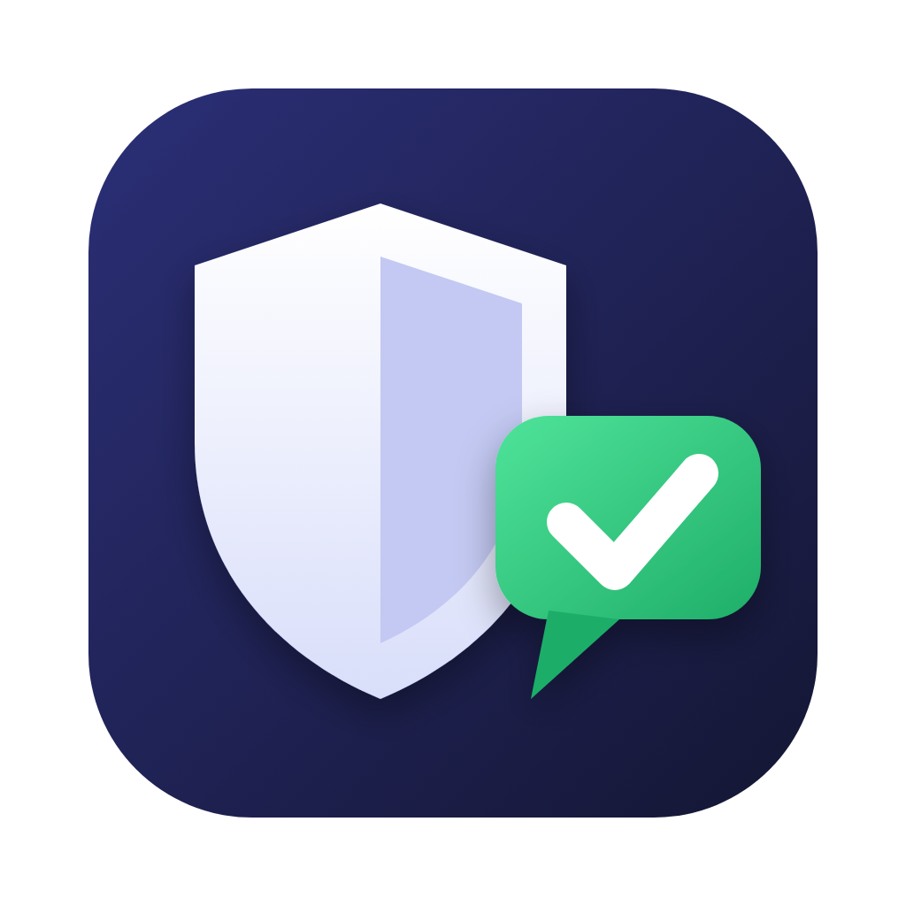

# LuLu Sidekick



LuLu（Objective-See の macOS 用ファイアウォール）が「LuLu Alert」を出したとき、通知の横に「許可してよいか・なぜか・おすすめの設定」を出すメニューバー常駐アプリです。

Allow や Block を押すのは自分です。このアプリは LuLu のボタンを押さず、LuLu の設定や規則のファイルも書き換えません。Accessibility API で通知の文字を読むだけです。

これは LuLu の公式のアプリではありません。Objective-See とは関係のない、個人の非公式な補助ツールで、LuLu のコードは含んでいません。動作は LuLu 4.5.7 の通知の画面で確かめています。LuLu の画面の作りが変わると、読めなくなることがあります。

## 必要なもの

- macOS 13 以降、Swift 6 系（Xcode か Command Line Tools）
- [LuLu](https://objective-see.org/products/lulu.html)
- [Claude Code](https://claude.com/claude-code) の `claude` CLI にログイン済みであること（判定に使う）

## 何をするか

1. 1秒ごとに LuLu の「LuLu Alert」ウィンドウを探し、プロセス名・pid・パス・引数・行き先ホスト・IP・ポート・逆引きを読む。
2. すぐに調べる。親プロセスの連鎖（pid から launchd まで）、パスの署名（`codesign -dv`）、行き先ホストの正引きと通知の IP の照合、引数に行き先が出てくるか。
3. `claude` CLI（モデル haiku）に、許可してよいか（verdict）と理由（why）だけを JSON で出させる。
4. おすすめの Rule Scope と Duration は、コードのルール（`Recommender`）で決める。curl・python・node などの汎用コマンドと、未署名のプログラムは Remote Endpoint、署名済みのアプリは Process にする。行き先がホスト名なら Always、IP だけなら Once にする。判定が「要注意」以上なら Block を勧める。
5. 通知の左隣（はみ出すなら下）に、判定（緑・黄・赤）・理由・おすすめ・起動元・行き先を出す。判定を待つ間は、調べた事実と「判定中…」を出す。AI の判定に失敗したら、その理由と事実だけを出す。

## 送るもの・残すもの

判定のために、通知に出た情報と調べた事実を Anthropic の Claude（`claude` CLI 経由）へ送ります。中身は、プロセスのパスと引数、親プロセスのコマンド、行き先のホスト・IP、署名の情報です。

引数とコマンドに入っている秘密は、送る前に `[伏せ字]` に置き換えます（`Redactor`）。対象は Authorization・Cookie・API キーのヘッダー、URL の `user:password@`、`-u user:password`、名前に token・password・secret などを含む値、よく知られた形のトークン（GitHub・OpenAI 形式・Slack・AWS のアクセスキー・JWT）です。すべての形の秘密を見つけられるわけではありません。

通知ごとの事実と判定は `~/Library/Logs/LuLuSidekick/alerts-YYYY-MM-DD.jsonl` に残します。ここに書く引数も、伏せ字にした後のものです。

## 入れ方

```bash
SIGN_IDENTITY="Apple Development: Your Name (TEAMID)" scripts/install.sh
```

ビルドして `~/Applications/LuLu Sidekick.app` に置き、起動します。初回の起動で、ログイン時の自動起動に登録します。メニューの「ログイン時に起動」で外せて、外した後は勝手に戻しません。`SIGN_IDENTITY` を省くと ad-hoc で署名し、再ビルドのたびにアクセシビリティの許可を付け直すことになります。

アクセシビリティの許可は次のとおりです。

1. 初回の起動で許可のダイアログが出る。
2. システム設定 > プライバシーとセキュリティ > アクセシビリティ で「LuLu Sidekick」をオンにする。
3. メニューの「終了」で止めて、起動し直す。

`claude` は、環境変数 `LULU_SIDEKICK_CLAUDE` → `PATH` → `~/.local/bin`・`~/.claude/local`・`/opt/homebrew/bin`・`/usr/local/bin` の順に探します。

## ビルドとテスト

```bash
scripts/build.sh                                   # build/LuLu Sidekick.app を作って署名
swift test                                         # 解析・調査・伏せ字・おすすめのテスト
RUN_CLAUDE=1 swift test --filter testRealClaude    # 実際に claude を呼ぶテスト
"build/LuLu Sidekick.app/Contents/MacOS/LuLuSidekick" --demo                      # サンプルのパネルを画面中央に出す
"build/LuLu Sidekick.app/Contents/MacOS/LuLuSidekick" --demo --snapshot out.png   # パネルだけを PNG に保存して終了
```

アイコンの元は `Resources/AppIcon.svg` です。書き出した `Resources/AppIcon.png`（1024px）から、`scripts/build.sh` が `.icns` を作ります。

判定に使う `claude` の呼び方は `claude -p --model haiku --setting-sources "" --strict-mcp-config --mcp-config '{"mcpServers":{}}' --disable-slash-commands --tools "" --no-session-persistence --system-prompt <方針> --output-format json <事実>` です。ユーザーの設定・hooks・MCP・スキルを読まず、ツールも使わせません。`--bare` は API キー専用で、ログイン済みの OAuth を読まないため使っていません。タイムアウトは30秒です。

## ライセンス

MIT
